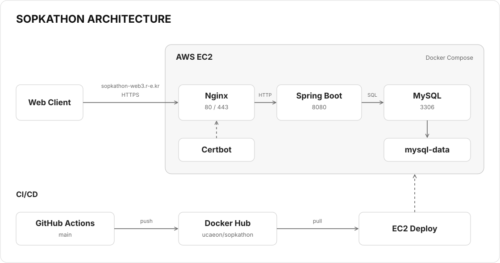

<div align="center">

<!-- 서비스 로고 추가 -->

# 프로젝트명

<!-- 서비스 한 줄 소개 추가 -->

[Overview](#overview) | [Contributors](#contributors) | [Tech Stack](#tech-stack) | [Architecture](#architecture) | [Getting Started](#getting-started) | [Convention](#convention) | [Operations](#operations)

</div>

<br>

<a id="overview"></a>

## 📌 Overview

<!-- 서비스 소개와 주요 기능 작성 -->

---

<a id="contributors"></a>

## 👥 Contributors

|  |  |  |
| :---: | :---: | :---: |
| **Backend Lead** | **Backend** | **Backend** |
| [유채원](https://github.com/ucaeon) | [김가영](https://github.com/gahyoung920-eng) | [정교은](https://github.com/kyooonnnggg) |

---

<a id="tech-stack"></a>

## 🛠️ Tech Stack

| 영역 | 기술 |
| --- | --- |
| 언어와 빌드 |  **Java 21**<br>Gradle Wrapper |
| 웹 API |  **Spring Boot 4.1.2**<br>Spring MVC와 Bean Validation |
| 데이터 접근 |  **MySQL 8.4**<br>Spring Data JPA와 Flyway |
| API 문서 |  **springdoc-openapi 3.2.0**<br>Swagger UI |
| 테스트 |  **JUnit Jupiter**<br>MockMvc와 Testcontainers |
| 실행과 배포 |  **Docker Compose**<br>Docker, AWS EC2와 Nginx |
| HTTPS |  **Let's Encrypt**<br>Certbot |
| CI/CD |  **GitHub Actions**<br>Docker Hub와 AWS OIDC |

---

<a id="architecture"></a>

## 🏗️ Architecture

<p align="center">
  
</p>

Controller → Service → Repository 구조를 사용하고 관련 코드는 도메인별 패키지에 모읍니다.

---

<a id="getting-started"></a>

## 🚀 Getting Started

JDK 21과 실행 중인 Docker가 필요합니다. 명령은 프로젝트 루트에서 실행합니다.

1. 환경변수 예시를 복사하고 로컬 DB 비밀번호를 변경합니다.

   ```bash
   cp .env.example .env
   ```

   | 키 | 기본값과 용도 |
   | --- | --- |
   | `SPRING_PROFILES_ACTIVE` | `local`, 로컬 실행 프로필 |
   | `SERVER_PORT` | `8080`, 앱 접속 포트 |
   | `DB_HOST` | `localhost`, IDE 또는 bootRun에서 사용할 DB 호스트 |
   | `DB_PORT` | `3307`, 로컬 MySQL 접속 포트 |
   | `DB_NAME` | `sopkathon`, DB 이름 |
   | `DB_USERNAME` | `sopkathon`, 앱의 DB 계정 |
   | `DB_PASSWORD` | 직접 설정할 앱 DB 계정 비밀번호 |
   | `DB_ROOT_PASSWORD` | 직접 설정할 MySQL 관리자 비밀번호 |

2. MySQL을 시작하고 상태가 `healthy`인지 확인합니다.

   ```bash
   docker compose up -d db
   docker compose ps db
   ```

3. 같은 터미널에서 환경변수를 불러오고 앱을 실행합니다.

   ```bash
   set -a
   source .env
   set +a
   ./gradlew bootRun
   ```

   IntelliJ에서 실행한다면 `Web3Application` 실행 구성의 환경변수 파일에 `.env`를 연결합니다. Spring Boot는 `.env`를 자동으로 읽지 않습니다.

4. [로컬 Swagger](http://localhost:8080/swagger-ui/index.html)에서 API 문서를 확인합니다.

앱과 DB를 모두 Docker로 실행하려면 2~3번 대신 아래 명령을 사용합니다.

```bash
docker compose up -d --build
```

**빌드와 테스트**

```bash
./gradlew clean build
```

DB 통합 테스트는 Testcontainers가 별도 MySQL을 실행하므로 Docker가 켜져 있어야 합니다.

**DB 스키마 변경**

- 서비스용 SQL은 `src/main/resources/db/migration/V1__create_tables.sql` 형식으로 추가합니다. 첫 마이그레이션을 추가할 때 폴더를 생성합니다.
- 다음 변경은 `V2`, `V3`처럼 새 파일로 추가하고, 이미 적용한 SQL은 수정하지 않습니다.
- Flyway가 스키마를 변경하고 JPA는 `ddl-auto: validate`로 검증합니다.
- 현재 서비스용 테이블은 없으며, `src/test/resources/db/test-migration`의 SQL은 테스트 전용입니다.

---

<a id="convention"></a>

## 💻 Convention

**이슈 생성 → 브랜치 생성 → PR → 리뷰 → 머지**

### 🎨 Code Style

- 네이버 캠퍼스 핵데이 Java 코딩 컨벤션을 따릅니다.
- 들여쓰기는 탭 4칸, 줄 길이는 120자 기준이며 한 줄 제어문에도 중괄호를 사용합니다.
- 클래스는 `UpperCamelCase`, 메서드와 변수는 `lowerCamelCase`, 상수는 `UPPER_SNAKE_CASE`로 작성합니다.

### 🏷️ Commit Tags

| 태그 | 사용 범위 |
| --- | --- |
| `feat` | 새 기능 |
| `fix` | 버그 수정 |
| `refactor` | 기능 변화 없는 코드 개선 |
| `style` | 코드 형식과 포맷 |
| `docs` | 문서 작성과 수정 |
| `test` | 테스트 작성과 수정 |
| `chore` | 설정과 의존성 |
| `ci` | CI/CD 설정 |
| `rename` | 파일과 폴더 이름 변경 또는 이동 |
| `remove` | 파일 삭제 |
| `hotfix` | 운영 환경 긴급 수정 |
| `init` | 프로젝트 초기 구성 |

### ✍️ Commit Message

- 커밋과 PR 제목은 `[type/#이슈번호] 제목` 형식으로 작성합니다.
- 타입은 영어 소문자, 제목은 한국어 50자 이내의 명사형으로 작성하고 마침표는 생략합니다.
- 커밋 하나에는 논리적 변경 하나를 담습니다.

```text
[chore/#14] 사용하지 않는 설정 정리
[docs/#14] 프로젝트 실행 및 운영 가이드 작성
```

### 🌿 Branch & Merge

브랜치는 `type/#이슈번호-작업-요약` 형식이며, 작업 요약은 영어 소문자와 하이픈으로 세 단어 이내로 작성합니다.

```text
chore/#14-operation-guide
feat/#15-post-list
```

| 구간 | 머지 방식 |
| --- | --- |
| 작업 브랜치 → `develop` | Squash and merge |
| `develop` → `main` | Create a merge commit |

일반 작업은 `develop`에서 분기합니다. `main`과 `develop`에는 직접 push하지 않고 PR로 반영합니다. 긴급 수정은 `main`에서 분기한 뒤 두 브랜치에 반영합니다.

### 📋 Issue & PR

- 작업 전에 이슈 템플릿을 선택하고 본인을 Assignee로 지정하며 타입 라벨을 붙입니다.
- 일반 작업은 이슈 하나, 브랜치 하나, PR 하나로 묶고 본문에 `Closes #이슈번호`를 작성합니다.
- 서버 팀원에게 리뷰를 요청합니다. 공통 코드, DB 스키마, 인증과 배포 설정 변경은 팀원 확인 후 머지합니다.
- Approve 필수 설정은 없으며, 셀프 리뷰와 빌드, 동작 확인 후 작성자가 머지합니다.
- 리뷰에는 `[필수]`, `[제안]`, `[질문]`, `[칭찬]` 머리말을 사용합니다.

### 📡 API Convention

| 항목 | 규칙 |
| --- | --- |
| 공통 응답 | `BaseResponse` 사용, `code`는 실제 HTTP 상태 코드와 같은 문자열 |
| 데이터 | Entity 대신 응답 DTO 사용, 반환값이 없으면 `data: null` |
| 검증 | DTO에서 요청 형식 검증, Service에서 업무 규칙 확인 |
| 예외 처리 | `BusinessException`과 `GlobalExceptionHandler` 사용 |
| 페이징 | 요청과 응답의 페이지 번호 모두 1부터 시작 |
| API 문서 | 응답 계약을 변경하면 Swagger도 함께 수정 |

---

<a id="operations"></a>

## 📦 Operations

| 구분 | 주소 |
| --- | --- |
| 운영 API | https://sopkathon-web3.r-e.kr |
| 운영 Swagger | https://sopkathon-web3.r-e.kr/swagger-ui/index.html |
| API 문서 JSON | https://sopkathon-web3.r-e.kr/v3/api-docs |
| 자동 배포 결과 | [GitHub Actions](https://github.com/SOPT-all/39-SOPKATHON-SERVER-WEB3/actions) |

### 배포

`main` 반영 시 테스트 → 이미지 빌드와 Docker Hub 업로드 → EC2 앱 교체 → HTTPS 응답 확인 순서로 실행합니다. 운영 환경변수는 EC2의 `.env`에서 유지합니다.

새 서버를 구성할 때는 `.env.prod.example`을 참고합니다. 실제 비밀번호와 SSH 키는 Git에 올리지 않습니다.

### 상태, 로그와 재시작

등록된 키 경로와 현재 EC2 공개 IP로 접속합니다.

```bash
ssh -i /path/to/sopkathon-key.pem ubuntu@<EC2_PUBLIC_IP>
```

EC2에서 다음 명령을 실행합니다.

```bash
cd /home/ubuntu/sopkathon
sudo docker compose -f docker-compose.prod.yml ps
sudo docker compose -f docker-compose.prod.yml logs --tail=100 -f app
```

로그 보기는 `Ctrl+C`로 종료합니다. 앱을 재시작하려면 아래 명령을 실행합니다.

```bash
sudo docker compose -f docker-compose.prod.yml restart app
```

### 배포 실패 시 복구

1. GitHub Actions의 실패 단계와 EC2 앱 로그를 확인합니다.
2. 이전 버전 복구가 필요하면 EC2 `.env`의 `APP_IMAGE`를 Docker Hub에 남아 있는 이전 커밋 태그로 변경합니다.
3. 아래 명령으로 앱을 교체하고 HTTPS 응답을 확인합니다.

   ```bash
   sudo docker compose -f docker-compose.prod.yml pull app
   sudo docker compose -f docker-compose.prod.yml up -d --no-deps --wait --wait-timeout 120 app
   sudo docker compose -f docker-compose.prod.yml exec -T nginx nginx -s reload
   curl --fail https://sopkathon-web3.r-e.kr/v3/api-docs
   ```

DB 마이그레이션이 포함된 배포는 앱만 되돌리면 호환되지 않을 수 있으므로 SQL 변경도 함께 확인합니다. `docker compose down -v`는 영속 볼륨을 삭제하므로 데이터 복구 용도로 사용하지 않습니다.
